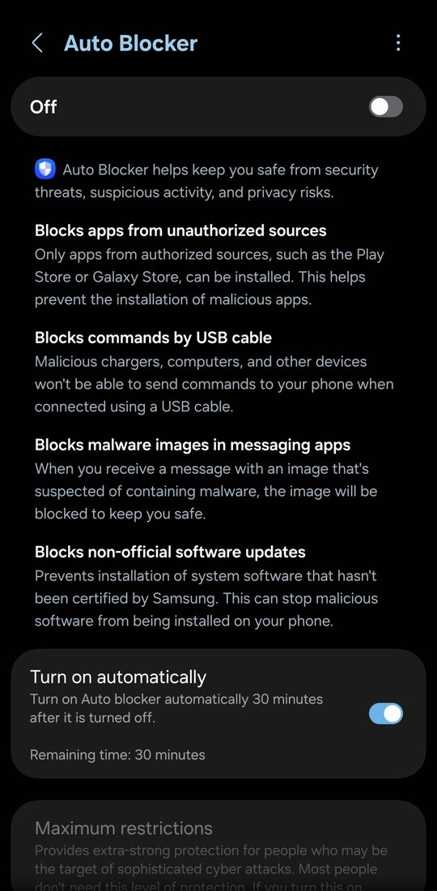
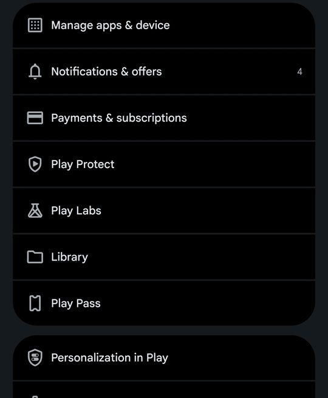
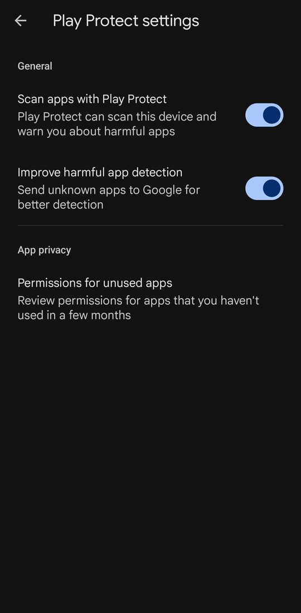

# absw-engine

Tooling to run **Angry Birds Star Wars 1.5.13** on 64-bit-only Android phones
such as the Galaxy S26 Ultra, whose CPUs cannot execute the game's 32-bit ARM engine.

Do not distribute the generated APK, `decoded-assets/` or `keystore/`.

## Install on a phone

You need a 64-bit Android phone with Android 8.0 or newer. The screenshots come from a Samsung Galaxy
(One UI) with the Google Play Store; other phones have the same steps under similar names.

### 1. Download the APK

1. On the phone, open the **Releases** page of the backup repository (`angry-birds-starwars-hd-arm64`; you
   need access to it) and open the latest release.
2. Under **Assets**, tap the APK you want. The SD and HD games are separate apps and can be installed side
   by side:

   | File | Game | Unlocked |
   | --- | --- | --- |
   | `AngryBirdsStarWars-arm64.apk` | Angry Birds Star Wars (SD) | No |
   | `AngryBirdsStarWars-arm64-unlocked.apk` | SD | Yes: all content |
   | `AngryBirdsStarWarsHD-arm64.apk` | Angry Birds Star Wars HD | No |
   | `AngryBirdsStarWarsHD-arm64-unlocked.apk` | HD | Yes: paid content only |

   The unlocked builds are described under [Unlocked builds](#unlocked-builds) (SD) and
   [Angry Birds Star Wars HD](#angry-birds-star-wars-hd) (HD) below.
3. Wait until the download finishes (about 43 MB for SD, 46 MB for HD).

### 2. Remove copies from other sources

Android installs an APK over an installed app only when both are signed with the same key. All builds
from this project share one key, so the normal and unlocked builds of a game replace each other and keep
the progress. If the phone has the same game from somewhere else (Google Play, another website), uninstall
it first: **Settings > Apps > Angry Birds > Uninstall**. Uninstalling deletes that copy's progress.

### 3. Turn off the manufacturer's blocker (Samsung Auto Blocker)

Auto Blocker only allows apps from the Play Store or the Galaxy Store, and it also blocks commands over USB.

1. Open **Settings > Security and privacy > Auto Blocker**.
2. Turn it **Off**.
3. Leave **Turn on automatically** on, so that Auto Blocker turns itself back on after 30 minutes.



On other brands, if the installer says that a security feature blocked the app, look for a similar
option under **Settings > Security**.

### 4. Turn off Play Protect scanning

Play Protect can block apps that did not come from the Play Store.

1. Open the **Play Store**, tap your profile picture (top right), then tap **Play Protect**.

   

2. Tap the gear icon (top right) to open **Play Protect settings**.
3. Turn off **Scan apps with Play Protect**. Turning off **Improve harmful app detection** as well keeps
   the phone from uploading the APK to Google.

   

If you leave scanning on and Play Protect shows a warning while installing, tap **More details** and then
**Install anyway**.

### 5. Install the APK

1. Open the downloaded file from the browser's downloads or the **Files** app.
2. The first time, Android says that this source is not allowed to install unknown apps. Tap **Settings**,
   turn on **Allow from this source**, and go back.
3. Tap **Install**. Both games appear on the home screen as **Angry Birds**.

### 6. First start

- Android may say that the app was built for an older version of Android. Tap **OK**: this is expected
  for these old games.
- Android may also show a one-time hint about full screen mode. Tap **Got it**.

### 7. Turn the protections back on

- **Play Store > profile picture > Play Protect > gear icon**: turn **Scan apps with Play Protect** back on.
- Auto Blocker turns itself back on after 30 minutes if **Turn on automatically** stayed on. Otherwise
  turn it on again in **Settings > Security and privacy > Auto Blocker**.

### Updating

Download the newer APK and repeat steps 3 to 5. The new build replaces the old one and keeps your progress.

### Troubleshooting

- **App not installed** or **package conflicts with an existing package**: a copy signed with another key
  is installed. See step 2.
- **There was a problem parsing the package**: the download is incomplete. Download the APK again.
- The games need a 64-bit phone. Phones that can still run 32-bit apps can use the original games instead.
- To report a crash, connect the phone to a computer with USB debugging on and run `adb logcat -d > log.txt`
  right after the crash. Auto Blocker must be off, because it blocks USB commands.

## How it works

`bridge/` builds a 64-bit `libAngryBirdsStarWars.so` that Java loads in place of the original. It:

1. Reserves a 4 GiB guest address space, where guest address A lives at host `base + A`.
2. Loads the original `armeabi-v7a` engine, shipped in the APK as `lib/arm64-v8a/libabsw_arm32.so`,
   plus a small ARM32 runtime (`bridge/guest/`: printf, setjmp, qsort, pthread_once).
3. Runs the engine with [dynarmic](https://github.com/Vita3K/dynarmic) (ARM32 → AArch64/x86-64 JIT),
   one JIT per host thread.
4. Services the engine's imports on the host (`src/hle_*.cpp`): libc, libm, pthread, stdio, GLES2,
   AAsset, log, with 32/64-bit struct conversion. Kernel "kuser helpers" are mapped at 0xffff0f60.
5. Gives the engine a synthetic 32-bit `JNIEnv`/`JavaVM` (`src/jni_bridge.cpp`) and registers
   trampolines for every Rovio `native` method found in the DEX (`natives.txt`).

Display adaptation (`src/display.cpp`) runs on the UI thread from the `nativeConfig` trampoline:

- The window draws under the camera cutout (`SHORT_EDGES`). Otherwise the window is narrower than
  `Display.getRealSize()`, which the game uses for layout.
- The game draws its 1280x800 UI sprites at native pixel size, so on 1440p screens the UI looks small.
  The GL surface is therefore fixed at 1080 px high and scaled up by the display hardware, and touch
  coordinates in `nativeInput` are scaled to match. `0` turns this off (native resolution). The height
  comes from, in order: `adb shell setprop debug.absw.render_height N`, the APK asset
  `absw/render_height` (written by `package_apk.py --render-height N`), then the default of 1080.

Lua display patches live in `bridge/lua/` as plain Lua source. The engine's Lua 5.1 includes its parser,
so it accepts source text. At packaging time, `tools/build_lua_patches.py`:

1. Packs each patch the way the game packs its scripts: LZMA, then AES-256-CBC, with the key recovered
   from your APK.
2. Keeps the original encrypted script as `<name>.orig.lua`.

Each patch loads its original with `loadLuaFileToObject` and then overrides the layout code that assumes
iPad screens:

- `menus/AnimatedTutorial.lua`: tutorials and story comics are scaled to fit the screen (the smaller of
  height/768 and width/950). Before, they used fixed x1.5/x2 steps based on screen width, so they
  overflowed on wide phones.
- `menus/EpisodeButton.lua`: the planet score panel keeps the phone font scale. Before, it applied the
  x0.4 iPad-Retina shrink to any screen at least 2000 px wide.

### Unlocked builds

`bridge/lua-unlocked/game.lua` is only applied by `make_release.sh unlocked`, which writes
`dist/AngryBirdsStarWars-arm64-unlocked.apk`. Each time the game starts, it marks the paid episodes
(Path of the Jedi, Boba Fett Missions) as purchased and opens every level, bonus levels included. It
also sets the four power-ups (Blaster Droid, Lightsaber Sling, Thermal Detonator, Clone Bird) and the
Millennium Falcon to 999, the largest count the HUD shows. As in the HD unlocked APK, both counts are
capped at 999 (see the HD list below), so power-up gifts and Falcon rewards stop there. These changes are
saved with the progress, so they remain if the stable APK is installed again.

Checked on the Galaxy S26 Ultra on 2026-10-17, over the owner's save: the log line
`[absw] unlocked: all episodes and levels; power-ups and Falcons at 999/999`, the Falcon at 999 in a
level's HUD, 998 after calling the Falcon, and 999 again after a restart. Before the power-up cap, the
power-up given at level start showed 1000 in the HUD of Tatooine 1-40 right after launch. With the cap
it shows 999, and three level restarts keep every counter at or under 999. Using a power-up still
lowers it to 998. Both unlocked APKs were repackaged with the bridge libraries of their previous builds,
so only `game.lua` changed.

`bridge/tools/make_release.sh` builds the phone APK with these patches. The packaging tools read
`original/angry_birds_sw.apk`. If the original APK is lost, `tools/rebuild_base_apk.py` rebuilds an
equivalent copy from a packaged APK plus the original 32-bit libraries.

### Angry Birds Star Wars HD

`make_release.sh hd` builds `dist/AngryBirdsStarWarsHD-arm64.apk` from `original/angry_birds_sw_hd.apk`
(`com.rovio.angrybirdsstarwarshd.premium.iap` 1.5.13). It installs next to the SD game. It uses the same
bridge without changes, because the HD and SD packages differ very little:

- The engine has the same ELF layout, the same 315 imports and the same 92 DEX native methods. Only
  46 bytes differ: one immediate in a byte store (`mov r3, #0` becomes `#1`, probably an HD flag), the
  variant string (`SD` becomes `HD`), and two swapped 20-character keys (probably analytics).
- The scripts are identical except `options.lua`, which adds `isHDVersion = true`. The AES key is the same.
- The assets add an iPad Retina set (`images/2048x1536`) and drop the 480x320 and 854x480 sets.

With `isHDVersion`, `selectAssetProfile` and `selectFontProfile` choose the 2048x1536 UI sprites and
fonts when the screen is at least 2048 px wide. On a 1440p phone these fit the screen as designed, so the HD
APK renders at native resolution (`--render-height 0`) and applies no Lua patches:

- A 1080 px cap would draw the 1536-high UI about 40% too large.
- The `EpisodeButton` x0.4 font scale is correct with the 2048x1536 fonts.
- The tutorials and comics already fit at 1440 px.

On screens narrower than 2048 px or shorter than about 1440 px, the game behaves as the original HD
game would there. This has not been checked yet.

`make_release.sh hd-unlocked` writes `dist/AngryBirdsStarWarsHD-arm64-unlocked.apk`. It adds
`bridge/lua-paid/game.lua`, which unlocks only what the HD shop sells. It does not open content earned
through progress. Each time the game starts, the patch:

- Restores Path of the Jedi and Bounty Missions through the game's own purchase-restore callback
  (`iapRestoreCallback`), the same path that runs when Google Play reports them as owned. The episode
  buttons then open as after a real purchase.
- Sets the four power-ups and the Millennium Falcon to 999.
- Caps `SettingsWrapper:addMightyEagles` at 999. That function is the only code that raises the Falcon
  count, so star rewards, level rewards and every other Falcon source stop at 999. Reward popups still
  show the full amount.
- Caps `SettingsWrapper:setPowerUpAmount` at 999. Every power-up change goes through it:
  `PowerupManager.addPowerUp` (the gift at level start, bundles, the power-up machine, video rewards,
  refunds) and using a power-up (count - 1). So no gain goes past 999, and spending is unchanged.
  Checked on the phone: 999 on every counter in Tatooine 1-3, also after two restarts.

These stay as in the original game:

- Base episodes still open through progress.
- Levels inside every episode, the paid ones included, still open one by one.
- Bonus levels still need stars. Boba Fett rocket packs and golden droids are not changed.

The HD shop has no "Remove Ads" item, although the Play catalog lists one. The SD `unlocked` variant
differs on purpose: it opens every level.

Behaviour that is compatible on purpose with Android 4.x bionic:

- `_ctype_` and `_tolower_tab_` are pointer variables.
- rwlocks can be re-entered by the thread that holds the write lock.
- A thread that joins itself is detached instead of failing.

## Build (WSL, user-space toolchain under `~/tools`)

```
bash tools/setup_toolchain.sh                      # NDK r27d, CMake, Ninja, Boost, dynarmic
ABIS=arm64-v8a bash bridge/tools/build.sh          # also: x86_64 for the emulator
python bridge/tools/package_apk.py <original.apk> dist/AngryBirdsStarWars-arm64.apk \
    --bridge-out bridge/out --abi arm64-v8a \
    --build-tools <sdk>/build-tools/36.0.0 --keystore keystore/absw-local.keystore
```

`bridge/tools/dev_cycle.sh` and `play_level1.sh` run the emulator loop: build, install, launch,
reach Tatooine 1-1, fire one bird and take screenshots. These scripts and `make_release.sh` write their
logs, screenshots and test APKs to `test-out/`. That folder is never committed. `dist/` holds only the
release APKs.

## Private backup

`main` (remote `origin`) holds only source. `tools/backup_workspace.sh` points branch `full` at a
snapshot: the commit at HEAD plus the "local workspace" section of `.gitignore` (original APKs, decoded
assets, keystore, release APKs, build outputs). Test and cache output is left out. Each snapshot
has the previous one as a parent, so `git push full refs/heads/full:main` does not need `--force`.

## Debugging

Logs use the tags `absw` (bridge) and `absw-guest` (engine stdout). A guest fault prints the guest PC,
LR and stack candidates as `libAngryBirdsStarWars.so+offset (symbol+delta)`. Build with `TRACE=ON` to
log every import call.

## Verified (Android 36 x86_64 emulator, 64-bit only: `x86_64,arm64-v8a`)

- x86_64 build, running natively:
  - menu, planet and level selection, comic, Tatooine 1-1 gameplay with physics and score;
  - audio at 16 kHz with 0 underruns;
  - progress saved across restarts.
- arm64 build, running under the emulator's ARM translation:
  - the same flow up to "Level cleared". This covers function only, not speed.
- HD, with the screen set to 3120x1440 (`wm size`):
  - x86_64: native-resolution menu, planet and level selection, comic, tutorial, Tatooine 1-1
    through "Level cleared", and progress saved across restarts;
  - arm64 under translation: start-up and the main menu only.

Not verified: running on real arm64 hardware (performance, Samsung firmware), in-app purchases
(they fail because of the new signature), ads, camera.
